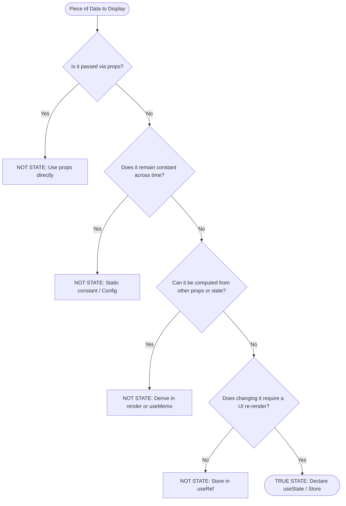
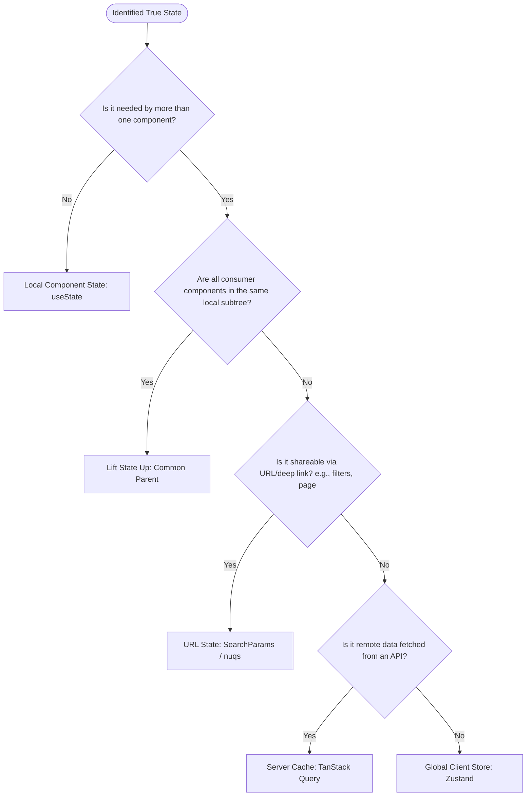
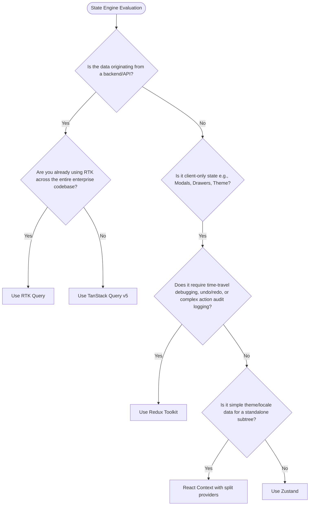
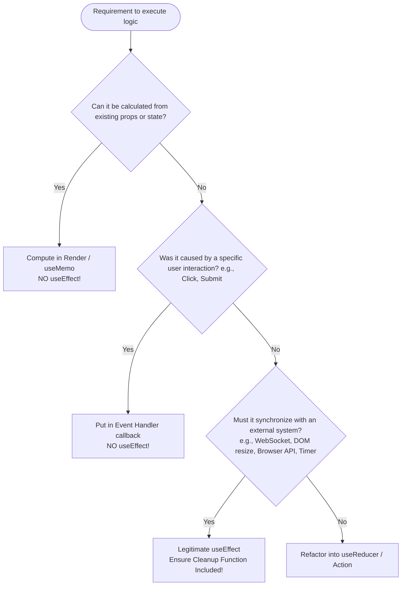

# Thinking in React: The Architect's Mental Models, State Decision Framework & Angular Rosetta Stone

> **Document Classification:** Architect-Level Design Guide & Mental Model Playbook  
> **Target Audience:** Senior Engineers, Tech Leads, and Software Architects designing React applications  
> **Key Themes:** Declarative Paradigms, State Engines (TanStack Query vs. Zustand vs. RTK), Decision Trees, and Angular-to-React Architectural Mapping.

---

## Table of Contents

1. [The React Mental Model: Paradigm Shift](#1-the-react-mental-model-paradigm-shift)
   - 1.1 The Fundamental Theorem: $UI = f(State)$
   - 1.2 Declarative vs. Imperative Thinking
   - 1.3 Angular to React: The Architectural Rosetta Stone
2. [Step-by-Step Practical Demonstration: Thinking in React by Example](#2-step-by-step-practical-demonstration-thinking-in-react-by-example)
   - 2.1 The Case: Enterprise Multi-Tenant Inventory Control Center
   - 2.2 Step 1: Deconstruct UI into an Atomic Component Hierarchy
   - 2.3 Step 2: Build the Static Version (Unidirectional Data Flow)
   - 2.4 Step 3: Identify the Minimal Complete Representation of UI State
   - 2.5 Step 4: Determine State Placement & Colocation Boundaries
   - 2.6 Step 5: Establish Inverse Data Flow
3. [State Management Taxonomy & Engine Selection Matrix](#3-state-management-taxonomy--engine-selection-matrix)
   - 3.1 The Taxonomy: Server Cache vs. Client UI vs. URL vs. Ephemeral State
   - 3.2 Deep Dive: TanStack Query (Server State Dominance)
   - 3.3 Deep Dive: Zustand (Modern Client UI State)
   - 3.4 Deep Dive: Redux Toolkit / RTK Query (Enterprise Centralized State)
   - 3.5 Architectural Comparison Matrix
4. [Architectural Decision Trees for React Thinking](#4-architectural-decision-trees-for-react-thinking)
   - 4.1 Decision Tree 1: "Is This Actually State or Computed Data?"
   - 4.2 Decision Tree 2: "Where Should This State Live?"
   - 4.3 Decision Tree 3: "Which State Engine Should I Pick?" (TanStack vs. Zustand vs. RTK)
   - 4.4 Decision Tree 4: "Effect vs. Event Handler vs. Derived Calculation"
5. [End-to-End Architectural Scenarios with Concrete Code](#5-end-to-end-architectural-scenarios-with-concrete-code)
   - 5.1 Scenario A: Server-Heavy CRUD & Infinite Caching (TanStack Query)
   - 5.2 Scenario B: Highly Interactive Multi-Step Checkout / Wizard (Zustand)
   - 5.3 Scenario C: Complex Normalized Workspace with Undo/Redo & Strict CQRS (Redux Toolkit)
   - 5.4 Scenario D: High-Frequency Real-Time Telemetry (Zustand + WebSockets + Canvas)
6. [Architectural Traps & Anti-Patterns (Angular Devs Beware)](#6-architectural-traps--anti-patterns-angular-devs-beware)
   - 6.1 Trap 1: Treating `useEffect` like `ngOnInit` / `ngOnChanges`
   - 6.2 Trap 2: State Duplication & Prop Mirroring
   - 6.3 Trap 3: The Context-as-State-Manager Anti-Pattern
   - 6.4 Trap 4: Direct Mutation & Stale Closures
   - 6.5 Trap 5: Overusing RxJS / Event Emitters Instead of Declarative State
7. [The Architect's Quick-Reference Card](#7-the-architects-quick-reference-card)

---

## 1. The React Mental Model: Paradigm Shift

### 1.1 The Fundamental Theorem: $UI = f(State)$

In modern React architecture, user interfaces are not constructed imperatively through sequences of DOM mutations. Instead, **the UI is a pure, idempotent projection of state at a discrete point in time**.

```
       +---------------------------------------------+
       |                  STATE                      |
       |  (Server Cache, Client UI, URL Params, DOM) |
       +---------------------------------------------+
                              │
                              ▼  f(State) [Pure Component Functions]
       +---------------------------------------------+
       |               VIRTUAL DOM / FIBER           |
       |            (Declarative Blueprint)          |
       +---------------------------------------------+
                              │
                              ▼  Reconciliation Engine (Diffing Algorithm)
       +---------------------------------------------+
       |                 HOST DOM                    |
       |      (Mutated only where changes occur)     |
       +---------------------------------------------+
```

When an event triggers an update:
1. You **do not** touch the DOM (e.g., no `document.getElementById` or `renderer2.addClass()`).
2. You **do not** mutate instance properties (e.g., `this.users.push(newUser)`).
3. You produce a **new immutable snapshot of state**. React's scheduler invokes your component functions again, compares the resulting Virtual DOM Fiber tree against the previous tree, and calculates the minimal set of real DOM operations necessary.

---

### 1.2 Declarative vs. Imperative Thinking

| Vector | Imperative Paradigm (Vanilla JS / Traditional OOP) | Declarative Paradigm (React) |
| :--- | :--- | :--- |
| **Mental Focus** | *How* to transition between states step-by-step. | *What* the UI looks like given specific inputs. |
| **DOM Manipulation** | Manual insertion, deletion, class toggling, and layout triggering. | Abstracted. You return JSX blueprints; React updates the DOM. |
| **Event Handling** | Event listener mutates the target element directly. | Event listener triggers a state transition ($S_{old} \rightarrow S_{new}$). |
| **Asynchronous Data** | Fetch callback directly appends nodes or updates template-bound class fields. | Async fetch resolves into state; UI reacts automatically to the new state snapshot. |

---

### 1.3 Angular to React: The Architectural Rosetta Stone

Engineers transitioning from Angular (or enterprise architects evaluating both) often struggle because Angular is an **object-oriented, framework-complete, push-based system**, whereas React is a **functional, minimalist, pull-based rendering library**.

```
+----------------------------------------------------------------------------------------------------+
|                                    ANGULAR VS. REACT ARCHITECTURE                                  |
+------------------------------+---------------------------------------+-----------------------------+
| Architectural Concept        | Angular (OOP / Platform)              | React (Functional / Library)|
+------------------------------+---------------------------------------+-----------------------------+
| **Core Abstraction**         | `@Component()` Class + HTML Template  | Pure Function returning JSX |
| **Input Data Passing**       | `@Input() data: Type`                 | Function arguments (`props`)|
| **Output / Events**          | `@Output() event = new EventEmitter()`| Callbacks (`onAction: () =>`)|
| **Template Directives**      | `*ngIf`, `*ngFor`, `[ngClass]`        | JavaScript: `&&`, `map()`,  |
|                              |                                       | ternary operators, `clsx`   |
| **Dependency Injection**     | Hierarchical DI via `@Injectable()`   | Custom Hooks, React Context,|
|                              | and constructor injection             | External Stores             |
| **Change Detection**         | Zone.js dirty checking or             | Virtual DOM Diffing via     |
|                              | Angular Signals (fine-grained push)   | Fiber Reconciliation (Pull) |
| **Two-Way Binding**          | `[(ngModel)]="value"`                 | Controlled components       |
|                              |                                       | (`value` + `onChange`)      |
| **Lifecycle Hooks**          | `ngOnInit`, `ngOnChanges`,            | `useEffect`, `useLayoutEff` |
|                              | `ngOnDestroy`                         | (Synchronization, not life) |
| **Data Transformation**      | `@Pipe({ name: 'filter' })`           | Pure JS functions, `useMemo`|
| **Reactive Streams**         | RxJS Observables, `BehaviorSubject`,  | Plain state primitives,     |
|                              | `async` pipe                          | `useSyncExternalStore`      |
| **Global State**             | NgRx / Akita / Services with Subjects | TanStack Query, Zustand, RTK|
+------------------------------+---------------------------------------+-----------------------------+
```

#### Key Conceptual Translation Rules:
1. **No Singleton Service Instances by Default**: In Angular, an `@Injectable({ providedIn: 'root' })` service is an instantiated singleton holding mutable state. In React, a custom hook (`useAuth()`) is **not** a singleton instance—it is executed fresh within every component that calls it. To share persistent state across components in React, you must use an external store (e.g., Zustand) or a React Context Provider.
2. **`useEffect` is NOT `ngOnInit`**:
   - `ngOnInit` runs exactly once when an Angular component class initializes.
   - `useEffect` is an **escape hatch for synchronization with external systems** (DOM, network, browser APIs). It synchronizes whenever its dependencies change, and in React 18/19 StrictMode, it fires twice in development to uncover uncleaned subscriptions.
3. **No Zone.js Magic**: Angular automatically detects async tasks (timers, microtasks) via Zone.js and triggers change detection. React only re-renders when a state setter (`setCount`) or hook trigger is explicitly executed.

---

## 2. Step-by-Step Practical Demonstration: Thinking in React by Example

To internalize how an architect thinks, let us step through the canonical 5-step React process by building a real-world enterprise interface: **An Multi-Tenant Inventory Control Center**.

### Requirements:
- Display list of inventory items with SKU, Name, Warehouse, Quantity, Status.
- Filter by Search Term and Warehouse Location.
- Toggle "Show Low Stock Only (< 10 units)".
- Multi-select rows with bulk action ("Transfer Warehouse", "Mark Inactive").
- Real-time total inventory valuation badge computed from selected items.

---

### 2.1 Step 1: Deconstruct UI into an Atomic Component Hierarchy

Draw boxes around every piece of UI and give them names. Follow the **Single Responsibility Principle (SRP)**: a component should ideally do only one thing.

```
+-----------------------------------------------------------------------------+
| InventoryDashboard [Root Container]                                        |
|  +-----------------------------------------------------------------------+  |
|  | InventoryHeader (Title, ValuationBadge)                               |  |
|  +-----------------------------------------------------------------------+  |
|  +-----------------------------------------------------------------------+  |
|  | InventoryFilterBar                                                    |  |
|  |   [SearchInput] [WarehouseSelect] [LowStockCheckbox]                  |  |
|  +-----------------------------------------------------------------------+  |
|  +-----------------------------------------------------------------------+  |
|  | BulkActionBar (Shows count selected, "Transfer", "Mark Inactive")     |  |
|  +-----------------------------------------------------------------------+  |
|  +-----------------------------------------------------------------------+  |
|  | InventoryTable                                                        |  |
|  |   +-----------------------------------------------------------------+ |  |
|  |   | TableHeader (Select All Checkbox, Column Titles)                | |  |
|  |   +-----------------------------------------------------------------+ |  |
|  |   | TableRow (Row Checkbox, SKU, Name, Warehouse, StockBadge)       | |  |
|  |   | TableRow ...                                                    | |  |
|  |   +-----------------------------------------------------------------+ |  |
|  +-----------------------------------------------------------------------+  |
+-----------------------------------------------------------------------------+
```

---

### 2.2 Step 2: Build the Static Version (Unidirectional Data Flow)

Build a version that renders the UI based on static props without using *any* state yet. State adds interactivity and complexity; separating the layout phase from interactivity prevents mental clutter.

```tsx
// Pure presentational static types
interface InventoryItem {
  id: string;
  sku: string;
  name: string;
  warehouse: string;
  quantity: number;
  unitPrice: number;
  status: 'ACTIVE' | 'LOW_STOCK' | 'INACTIVE';
}

interface InventoryTableProps {
  items: InventoryItem[];
  selectedIds: Set<string>;
}

export function InventoryTable({ items, selectedIds }: InventoryTableProps) {
  return (
    <table className="w-full border-collapse border border-neutral-200">
      <thead>
        <tr className="bg-neutral-50 text-left text-sm font-semibold">
          <th className="p-3"><input type="checkbox" readOnly /></th>
          <th className="p-3">SKU</th>
          <th className="p-3">Item Name</th>
          <th className="p-3">Warehouse</th>
          <th className="p-3">Qty</th>
        </tr>
      </thead>
      <tbody>
        {items.map((item) => (
          <tr key={item.id} className="border-t hover:bg-neutral-50">
            <td className="p-3">
              <input type="checkbox" checked={selectedIds.has(item.id)} readOnly />
            </td>
            <td className="p-3 font-mono text-xs">{item.sku}</td>
            <td className="p-3">{item.name}</td>
            <td className="p-3">{item.warehouse}</td>
            <td className="p-3 font-medium">{item.quantity}</td>
          </tr>
        ))}
      </tbody>
    </table>
  );
}
```

---

### 2.3 Step 3: Identify the Minimal Complete Representation of UI State

To make the UI interactive, you must define the **minimal set of mutable state**. Do not repeat yourself (DRY).

#### The 3 Golden Litmus Tests:
Ask these 3 questions for every piece of data:
1. **Is it passed in from a parent via props?** If so, it is **not state**.
2. **Does it remain unchanged over time?** If so, it is **not state**.
3. **Can you compute it from any other state or props in your component?** If so, it is **absolutely not state**!

#### Evaluation of Candidate Data:

| Data Item | Can it be Computed? | Is it Passed via Props? | Is it True State? | Rationale |
| :--- | :---: | :---: | :---: | :--- |
| **Raw Inventory List** | No | No (Fetched from server) | **YES (Server State)** | Sourced asynchronously from API. |
| **Search Filter String** | No | No | **YES (Local/URL State)** | Mutated by user keystrokes. |
| **Warehouse Filter Value** | No | No | **YES (Local/URL State)** | Mutated by user dropdown selection. |
| **"Low Stock Only" Flag** | No | No | **YES (Local/URL State)** | Boolean toggled by checkbox. |
| **Filtered Items List** | **YES** | No | ❌ **NOT STATE** | Derived via `items.filter(...)`. Computing in render is instant; saving in state causes synchronization bugs! |
| **Selected Item IDs** | No | No | **YES (Local State)** | `Set<string>` mutated by row checks. |
| **Total Valuation Badge** | **YES** | No | ❌ **NOT STATE** | Derived via `selectedItems.reduce((acc, i) => acc + i.unitPrice * i.quantity, 0)`. |
| **"Select All" Checkbox Status**| **YES** | No | ❌ **NOT STATE** | Derived: `selectedIds.size === filteredItems.length`. |

> **Architectural Law:** Every time you duplicate derived data into state, you open the door to state desynchronization bugs. Compute during render instead.

---

### 2.4 Step 4: Determine State Placement & Colocation Boundaries

For each piece of state identified:
1. Identify every component that renders something based on that state.
2. Find their **common parent component** (a component above them all in the hierarchy).
3. Either place the state directly into that common parent or lift it to an external store if multiple distant subtrees require it.

```
Common Parent: <InventoryDashboard />
  ├── Contains: searchTerm, warehouseFilter, isLowStockOnly, selectedIds
  │
  ├── Passes filters down to ──► <InventoryFilterBar />
  ├── Computes filtered list ──► Derived in render
  ├── Passes selected count to ──► <BulkActionBar />
  ├── Passes valuation to ────► <InventoryHeader />
  └── Passes filtered items & selectedIds to ──► <InventoryTable />
```

---

### 2.5 Step 5: Establish Inverse Data Flow

Child components must never mutate state directly. They emit events via typed callbacks to request state changes from the owning parent.

```tsx
// src/features/inventory/components/InventoryDashboard.tsx
import { useState, useMemo } from 'react';
import { InventoryFilterBar } from './InventoryFilterBar';
import { InventoryTable } from './InventoryTable';
import { BulkActionBar } from './BulkActionBar';
import { InventoryHeader } from './InventoryHeader';
import type { InventoryItem } from '../types';

interface InventoryDashboardProps {
  initialItems: InventoryItem[];
}

export function InventoryDashboard({ initialItems }: InventoryDashboardProps) {
  // 1. Minimal State Declarations
  const [items, setItems] = useState<InventoryItem[]>(initialItems);
  const [searchTerm, setSearchTerm] = useState('');
  const [selectedWarehouse, setSelectedWarehouse] = useState<string>('ALL');
  const [lowStockOnly, setLowStockOnly] = useState(false);
  const [selectedIds, setSelectedIds] = useState<Set<string>>(new Set());

  // 2. Pure Derived Computations (Zero useEffect, Zero duplicate state)
  const filteredItems = useMemo(() => {
    return items.filter((item) => {
      const matchesSearch = item.name.toLowerCase().includes(searchTerm.toLowerCase()) ||
                            item.sku.toLowerCase().includes(searchTerm.toLowerCase());
      const matchesWarehouse = selectedWarehouse === 'ALL' || item.warehouse === selectedWarehouse;
      const matchesStock = !lowStockOnly || item.quantity < 10;

      return matchesSearch && matchesWarehouse && matchesStock;
    });
  }, [items, searchTerm, selectedWarehouse, lowStockOnly]);

  const selectedValuation = useMemo(() => {
    return items
      .filter((item) => selectedIds.has(item.id))
      .reduce((sum, item) => sum + item.quantity * item.unitPrice, 0);
  }, [items, selectedIds]);

  // 3. Inverse Data Flow Callbacks
  const handleToggleSelectRow = (id: string) => {
    setSelectedIds((prev) => {
      const next = new Set(prev);
      if (next.has(id)) next.delete(id);
      else next.add(id);
      return next;
    });
  };

  const handleSelectAll = (checked: boolean) => {
    if (checked) {
      setSelectedIds(new Set(filteredItems.map((i) => i.id)));
    } else {
      setSelectedIds(new Set());
    }
  };

  const handleBulkMarkInactive = () => {
    setItems((prev) =>
      prev.map((item) => (selectedIds.has(item.id) ? { ...item, status: 'INACTIVE' } : item))
    );
    setSelectedIds(new Set());
  };

  return (
    <div className="space-y-6 p-6 max-w-7xl mx-auto">
      <InventoryHeader totalValuation={selectedValuation} selectedCount={selectedIds.size} />

      <InventoryFilterBar
        searchTerm={searchTerm}
        onSearchChange={setSearchTerm}
        warehouse={selectedWarehouse}
        onWarehouseChange={setSelectedWarehouse}
        lowStockOnly={lowStockOnly}
        onLowStockToggle={setLowStockOnly}
      />

      {selectedIds.size > 0 && (
        <BulkActionBar
          count={selectedIds.size}
          onMarkInactive={handleBulkMarkInactive}
        />
      )}

      <InventoryTable
        items={filteredItems}
        selectedIds={selectedIds}
        isAllSelected={filteredItems.length > 0 && selectedIds.size === filteredItems.length}
        onToggleRow={handleToggleSelectRow}
        onToggleAll={handleSelectAll}
      />
    </div>
  );
}
```

---

## 3. State Management Taxonomy & Engine Selection Matrix

A common architectural failure in React codebases is using one state tool for all problems. Modern frontend applications require a **specialized state taxonomy**.

```
                           +-------------------------------------+
                           |      FRONTEND STATE ECOSYSTEM       |
                           +-------------------------------------+
                                              │
               ┌──────────────────────────────┼──────────────────────────────┐
               ▼                              ▼                              ▼
    +--------------------+         +--------------------+         +--------------------+
    |    SERVER STATE    |         |  CLIENT UI STATE   |         |     URL STATE      |
    | (Async / Remote)   |         | (Sync / Client-app)|         | (Deep-linkable)    |
    +--------------------+         +--------------------+         +--------------------+
    | • TanStack Query   |         | • Zustand          |         | • React Router     |
    | • RTK Query        |         | • Redux Toolkit    |         | • nuqs             |
    | • SWR              |         | • Jotai / Context  |         | • URLSearchParams  |
    +--------------------+         +--------------------+         +--------------------+
```

---

### 3.1 Deep Dive: TanStack Query (Server State Dominance)

#### The Mental Model:
Server state is **not owned by your client**. It is an asynchronous snapshot of remote data that is inherently out of date the moment it reaches the browser.

#### Architectural Capabilities:
- **Automatic Stale-While-Revalidate**: Serves cached data instantly while refetching in the background.
- **Deduplication**: Collapses 10 identical simultaneous requests across 10 components into 1 network call.
- **Garbage Collection**: Evicts unused cache entries automatically via `gcTime`.
- **Query Key Hierarchies**: Enables structural invalidation (e.g., invalidate all `['projects']` lists on create).
- **Optimistic Mutations**: Updates client UI instantaneously before server round-trips with automatic rollback on error.

---

### 3.2 Deep Dive: Zustand (Modern Client UI State)

#### The Mental Model:
Zustand is a minimalist, un-opinionated store based on the **Observer Pattern and Closures**. It stores data outside of the React Fiber tree and leverages `useSyncExternalStore` for subscriptions.

#### Why Architects Choose Zustand over Context API:
1. **Zero Re-Render Cascades**: React Context re-renders *every* consumer component whenever *any* value inside the context object changes. Zustand supports **atomic selectors**: components only re-render if their specifically selected property changes.
2. **Outside-of-React Access**: Can read and mutate state inside Axios interceptors, WebSockets, or utility functions without needing a React component context.
3. **No Provider Hell**: Components do not need to be wrapped inside deeply nested `<Provider>` trees.

```typescript
// Zustand Selector Granularity:
// This component ONLY re-renders if 'isSidebarOpen' toggles, ignoring all other store mutations!
const isSidebarOpen = useAppStore((state) => state.isSidebarOpen);
```

---

### 3.3 Deep Dive: Redux Toolkit / RTK Query (Enterprise Centralized State)

#### The Mental Model:
Redux implements the **Command Query Responsibility Segregation (CQRS)** pattern on the client:
- **Commands**: Dispatched Actions (intent to mutate).
- **Reducers**: Pure state transition machines.
- **Selectors**: Queries against a single centralized state tree.

#### When is Redux Toolkit Genuinely Justified?
In modern development, RTK is often over-engineered for standard CRUD apps. However, it remains the gold standard in specific scenarios:
1. **Large Enterprise Teams (> 50 devs)** requiring strict architectural guardrails, enforceable action logs, and standardized design patterns.
2. **Complex State Dependencies**: Where an action in Domain A needs to trigger state modifications across Domains B, C, and D simultaneously.
3. **Auditing & Time-Travel Debugging**: Financial, military, or regulated medical applications where every state transition must be serialized, timestamped, and replayable.
4. **Offline-First Synchronization Engines**: Requiring action queue serialization to IndexedDB and replay on reconnection.

---

### 3.4 Architectural Comparison Matrix

| Capability / Dimension | TanStack Query v5 | Zustand | Redux Toolkit (RTK) | React Context API |
| :--- | :--- | :--- | :--- | :--- |
| **Primary Specialty** | Server State & Remote Cache | Global Client UI State | Complex Global State & CQRS | Dependency Injection / Scope |
| **Bundle Footprint** | ~12 kB | **~1.2 kB** | ~11 kB (with Redux core) | **0 kB (Native React)** |
| **Boilerplate Ratio** | Low | **Ultra-Low** | Medium-High | Low |
| **Re-render Optimization** | Built-in via structural sharing | Atomic selectors (`state => state.val`) | Reselect memoized selectors | ❌ Poor (Tears without splitting) |
| **Async Flow Handling** | Native (`queryFn`, `mutationFn`) | Manual async functions | `createAsyncThunk` / RTK Query | Manual `useEffect` orchestration |
| **External React Access** | Yes (`queryClient.getQueryData`) | Yes (`store.getState()`) | Yes (`store.getState()`) | ❌ Impossible (Hook bound) |
| **DevTools Support** | Dedicated Query DevTools | Redux DevTools extension | Redux DevTools (Gold standard) | React DevTools only |
| **Angular Equivalent** | NgRx ComponentStore / HTTP Cache | Service with `BehaviorSubject` | Full NgRx Store + Effects | Module-level Hierarchical DI |

---

## 4. Architectural Decision Trees for React Thinking

### 4.1 Decision Tree 1: "Is This Actually State or Computed Data?"



---

### 4.2 Decision Tree 2: "Where Should This State Live?"



---

### 4.3 Decision Tree 3: "Which State Engine Should I Pick?"



---

### 4.4 Decision Tree 4: "Effect vs. Event Handler vs. Derived Calculation"

A pervasive architectural smell in React codebases is the overuse of `useEffect` for tasks that should be event handlers or derived calculations.



---

## 5. End-to-End Architectural Scenarios with Concrete Code

### 5.1 Scenario A: Server-Heavy CRUD & Infinite Caching (TanStack Query)

**Architectural Context:** E-Commerce Product Catalog with infinite scrolling, optimistic review submissions, and automatic cache invalidation.

```tsx
// src/features/products/api/useProducts.ts
import { useInfiniteQuery, useMutation, useQueryClient } from '@tanstack/react-query';
import axios from 'axios';

interface Product {
  id: string;
  title: string;
  price: number;
}

interface ProductsPage {
  items: Product[];
  nextCursor?: string;
}

export const productKeys = {
  all: ['products'] as const,
  infinite: () => [...productKeys.all, 'infinite'] as const,
};

export function useInfiniteProducts() {
  return useInfiniteQuery({
    queryKey: productKeys.infinite(),
    queryFn: async ({ pageParam }) => {
      const { data } = await axios.get<ProductsPage>('/api/products', {
        params: { cursor: pageParam },
      });
      return data;
    },
    initialPageParam: undefined as string | undefined,
    getNextPageParam: (lastPage) => lastPage.nextCursor,
    staleTime: 1000 * 60 * 5, // Data remains fresh for 5 mins
  });
}

export function useAddReviewMutation(productId: string) {
  const queryClient = useQueryClient();

  return useMutation({
    mutationFn: async (review: { rating: number; comment: string }) => {
      return axios.post(`/api/products/${productId}/reviews`, review);
    },
    onSuccess: () => {
      // Intentionally invalidate the entire product tree cache to force background re-sync
      queryClient.invalidateQueries({ queryKey: productKeys.all });
    },
  });
}
```

---

### 5.2 Scenario B: Highly Interactive Multi-Step Checkout / Wizard (Zustand)

**Architectural Context:** Multi-step wizard with complex conditional validation across steps, persistence to `sessionStorage`, and atomic selector consumption to prevent re-renders.

```typescript
// src/features/checkout/stores/useCheckoutStore.ts
import { create } from 'zustand';
import { persist, createJSONStorage } from 'zustand/middleware';

export interface ShippingAddress {
  fullName: string;
  addressLine1: string;
  city: string;
  zipCode: string;
}

export interface PaymentDetails {
  method: 'CREDIT_CARD' | 'PAYPAL';
  cardLastFour?: string;
}

interface CheckoutState {
  currentStep: number;
  shipping: ShippingAddress;
  payment: PaymentDetails;
  isProcessing: boolean;
  
  // Actions
  setStep: (step: number) => void;
  updateShipping: (shipping: Partial<ShippingAddress>) => void;
  updatePayment: (payment: Partial<PaymentDetails>) => void;
  resetCheckout: () => void;
}

const initialValues = {
  currentStep: 1,
  shipping: { fullName: '', addressLine1: '', city: '', zipCode: '' },
  payment: { method: 'CREDIT_CARD' as const },
  isProcessing: false,
};

export const useCheckoutStore = create<CheckoutState>()(
  persist(
    (set) => ({
      ...initialValues,
      setStep: (step) => set({ currentStep: step }),
      updateShipping: (shipping) =>
        set((state) => ({ shipping: { ...state.shipping, ...shipping } })),
      updatePayment: (payment) =>
        set((state) => ({ payment: { ...state.payment, ...payment } })),
      resetCheckout: () => set(initialValues),
    }),
    {
      name: 'checkout-wizard-cache',
      storage: createJSONStorage(() => sessionStorage),
    }
  )
);

// High-Performance Atomic Selectors
export const useCheckoutStep = () => useCheckoutStore((state) => state.currentStep);
export const useShippingInfo = () => useCheckoutStore((state) => state.shipping);
```

---

### 5.3 Scenario C: Complex Normalized Workspace with Undo/Redo & Strict CQRS (Redux Toolkit)

**Architectural Context:** Diagramming Canvas / Spreadsheet app where elements are normalized by ID, actions must be serialized into an undo stack, and state updates must adhere to strict immutability.

```typescript
// src/features/canvas/store/canvasSlice.ts
import { createSlice, createEntityAdapter, type PayloadAction } from '@reduxjs/toolkit';

export interface CanvasNode {
  id: string;
  type: 'RECTANGLE' | 'CIRCLE' | 'TEXT';
  x: number;
  y: number;
  label: string;
}

// 1. Normalized Entity Adapter (O(1) lookups by ID)
const nodesAdapter = createEntityAdapter<CanvasNode>({
  selectId: (node) => node.id,
});

interface CanvasState {
  nodes: ReturnType<typeof nodesAdapter.getInitialState>;
  history: Array<ReturnType<typeof nodesAdapter.getInitialState>>;
  selectedNodeId: string | null;
}

const initialState: CanvasState = {
  nodes: nodesAdapter.getInitialState(),
  history: [],
  selectedNodeId: null,
};

export const canvasSlice = createSlice({
  name: 'canvas',
  initialState,
  reducers: {
    addNode: (state, action: PayloadAction<CanvasNode>) => {
      // Save snapshot for Undo
      state.history.push(JSON.parse(JSON.stringify(state.nodes)));
      nodesAdapter.addOne(state.nodes, action.payload);
    },
    updateNodePosition: (
      state,
      action: PayloadAction<{ id: string; x: number; y: number }>
    ) => {
      nodesAdapter.updateOne(state.nodes, {
        id: action.payload.id,
        changes: { x: action.payload.x, y: action.payload.y },
      });
    },
    undo: (state) => {
      const previousState = state.history.pop();
      if (previousState) {
        state.nodes = previousState;
      }
    },
    selectNode: (state, action: PayloadAction<string | null>) => {
      state.selectedNodeId = action.payload;
    },
  },
});

export const { addNode, updateNodePosition, undo, selectNode } = canvasSlice.actions;
```

---

### 5.4 Scenario D: High-Frequency Real-Time Telemetry (Zustand + WebSockets)

**Architectural Context:** Stock Market / Crypto Trading Dashboard receiving 500 socket ticks/sec. React components cannot re-render at 500fps without dropping frames.

```typescript
// src/features/ticker/store/useTickerStore.ts
import { create } from 'zustand';

interface TickerData {
  symbol: string;
  price: number;
  timestamp: number;
}

interface TickerStore {
  tickers: Map<string, TickerData>;
  updateTicker: (ticker: TickerData) => void;
}

export const useTickerStore = create<TickerStore>()((set) => ({
  tickers: new Map(),
  updateTicker: (ticker) =>
    set((state) => {
      const nextMap = new Map(state.tickers);
      nextMap.set(ticker.symbol, ticker);
      return { tickers: nextMap };
    }),
}));

// WebSocket Bridge (Completely outside React's render loop!)
export function initTickerWebSocket() {
  const socket = new WebSocket('wss://stream.marketdata.com');

  socket.onmessage = (event) => {
    const rawData: TickerData = JSON.parse(event.data);
    // Transient update directly into Zustand without triggering full page re-renders
    useTickerStore.getState().updateTicker(rawData);
  };
}
```

```tsx
// Micro-Component subscribing exclusively to its specific ticker symbol
export function TickerPriceBadge({ symbol }: { symbol: string }) {
  // Selector guarantees this badge ONLY renders when its specific symbol price changes
  const price = useTickerStore((state) => state.tickers.get(symbol)?.price);

  return (
    <span className="font-mono text-sm px-2 py-1 bg-neutral-100 rounded">
      {symbol}: {price ? `$${price.toFixed(2)}` : 'Loading...'}
    </span>
  );
}
```

---

## 6. Architectural Traps & Anti-Patterns (Angular Devs Beware)

### 6.1 Trap 1: Treating `useEffect` like `ngOnInit` / `ngOnChanges`

In Angular, developers write logic inside lifecycle hooks:
```typescript
// Angular (Imperative Lifecycle)
ngOnChanges(changes: SimpleChanges) {
  if (changes['userId']) {
    this.fetchUserProfile(this.userId);
  }
}
```

Translating this directly into React creates severe cascading render loops:
```tsx
// ❌ ANTI-PATTERN: React as Imperative Lifecycles
function UserProfile({ userId }: { userId: string }) {
  const [profile, setProfile] = useState<Profile | null>(null);

  useEffect(() => {
    // Triggers a second render cycle after initial render paint!
    fetch(`/api/users/${userId}`)
      .then((res) => res.json())
      .then((data) => setProfile(data));
  }, [userId]);

  return <div>{profile?.name}</div>;
}

// ✅ ARCHITECTURAL CORRECTION: Declarative Server State
function UserProfile({ userId }: { userId: string }) {
  // Declarative, cached, deduplicated, zero manual lifecycle management
  const { data: profile, isLoading } = useQuery({
    queryKey: ['users', userId],
    queryFn: () => fetchUser(userId),
  });

  if (isLoading) return <Spinner />;
  return <div>{profile?.name}</div>;
}
```

---

### 6.2 Trap 2: State Duplication & Prop Mirroring

```tsx
// ❌ ANTI-PATTERN: Storing derived state in useState
function DiscountPrice({ originalPrice, discountPercent }: { originalPrice: number; discountPercent: number }) {
  const [discounted, setDiscounted] = useState(0);

  // Synchronizing state in an effect is a major anti-pattern
  useEffect(() => {
    setDiscounted(originalPrice * (1 - discountPercent / 100));
  }, [originalPrice, discountPercent]);

  return <div>Final: ${discounted}</div>;
}

// ✅ ARCHITECTURAL CORRECTION: Pure In-Line Computation
function DiscountPrice({ originalPrice, discountPercent }: { originalPrice: number; discountPercent: number }) {
  // Calculated on the fly in nanoseconds; impossible to become stale or desynchronized!
  const discounted = originalPrice * (1 - discountPercent / 100);

  return <div>Final: ${discounted}</div>;
}
```

---

### 6.3 Trap 3: The Context-as-State-Manager Anti-Pattern

In Angular, injecting a service at a module or root level does not trigger view updates unless a property bound via an Observable / Signal updates.

In React, **React Context is NOT a state manager—it is an injection vector**. Every component consuming a Context will unconditionally re-render whenever the Context Provider value reference changes.

```tsx
// ❌ ANTI-PATTERN: Monolithic Context storing fast-updating data
interface BigContextValue {
  theme: string;
  mousePosition: { x: number; y: number }; // High frequency!
  user: User;
}

// Every component reading 'theme' re-renders at 60fps as the mouse moves!
```

#### Architectural Fix:
1. **Split Providers**: Separate static/low-frequency context (`ThemeContext`, `AuthContext`) from high-frequency context.
2. **Migrate to an External Store (Zustand)**: Use atomic selectors when state changes rapidly.

---

### 6.4 Trap 4: Direct Mutation & Stale Closures

Angular’s Zone.js can catch direct array mutations:
```typescript
// Angular works with this because Zone.js runs dirty checks on the array elements:
this.items.push(newItem);
```

In React, mutating an existing reference produces a no-op because React checks `Object.is(oldState, newState)`:
```typescript
// ❌ FAILS IN REACT:
const [items, setItems] = useState<string[]>([]);
items.push('New Value');
setItems(items); // React sees the SAME array reference in memory! Re-render is SKIPPED!

// ✅ ARCHITECTURAL REQUIREMENT: Structural Sharing & Immutability
setItems((prev) => [...prev, 'New Value']); // New memory reference created
```

---

### 6.5 Trap 5: Overusing RxJS / Event Emitters Instead of Declarative State

Angular developers often bring large RxJS subject pipelines into React. While RxJS is powerful, wiring `Subject.next()` inside React components bypasses React's declarative Fiber scheduler, leading to memory leaks and synchronization tearing.

When listening to external non-React event streams, use React's official subscription engine: `useSyncExternalStore`.

---

## 7. The Architect's Quick-Reference Card

### When to Use Which Tool: Summary Decision Matrix

```
+----------------------------------------------------------------------------------------------------+
|                                    ARCHITECT'S SELECTION MATRIX                                    |
+--------------------------+----------------------------+--------------------------------------------+
| State Classification     | Recommended Engine         | Primary Reason                             |
+--------------------------+----------------------------+--------------------------------------------+
| Server / Remote Data     | **TanStack Query v5**      | Automatic caching, background refetch,     |
|                          |                            | query key factories, zero manual sync.     |
| Global UI Controls       | **Zustand**                | Tiny bundle (1.2kB), zero boilerplate,     |
|                          |                            | granular atomic selectors.                 |
| Complex Entity Graphs    | **Redux Toolkit**          | Normalized adapters, time-travel,          |
| with Undo/Audit Logs     |                            | centralized CQRS and middleware.           |
| URL / Navigational       | **React Router / nuqs**    | Shareable URLs, deep links, browser back/  |
|                          |                            | forward navigation compatibility.          |
| Local UI Toggle          | **useState / useReducer**  | Isolated to single component boundary.     |
| Scope / Injector         | **React Context**          | Passing compound component state or design |
|                          |                            | system themes down a localized subtree.    |
+--------------------------+----------------------------+--------------------------------------------+
```

### The 4 Mental Commandments of Thinking in React:
1. **$UI = f(State)$**: Do not touch the DOM. Update state; let React diff and commit.
2. **Never Duplicate Derived State**: If a value can be computed from props or existing state, compute it during render.
3. **Effects are for Synchronization, Not Flow Control**: If logic is triggered by a user action, put it in an event handler, not in a `useEffect`.
4. **Choose the Right State Engine for the Right State Sphere**: Do not force server cache into Zustand; do not force local modal toggles into Redux.
